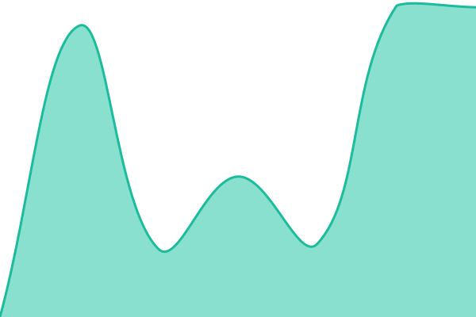
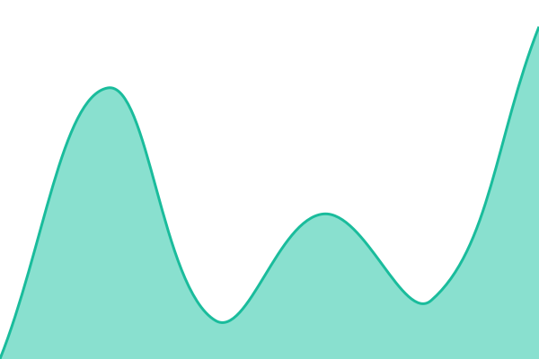
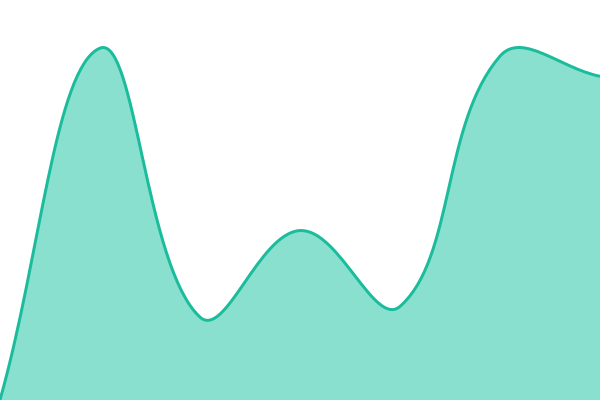

# [📈 Estado actual](https://status.suarezsaas.com): <!--live status--> **🟧 Partial outage**

This repository contains the open-source uptime monitor and status page for [José Suárez](https://status.suarezsaas.com), powered by [Upptime](https://github.com/upptime/upptime).

With [Upptime](https://upptime.js.org), you can get your own unlimited and free uptime monitor and status page, powered entirely by a GitHub repository. We use [Issues](https://github.com/josegsuarezg/suarezsaas-status/issues) as incident reports, [Actions](https://github.com/josegsuarezg/suarezsaas-status/actions) as uptime monitors, and [Pages](https://status.suarezsaas.com) for the status page.

## [📈 Live Status](https://demo.upptime.js.org): <!--live status--> **🟧 Partial outage**

<!--start: status pages-->
<!-- This summary is generated by Upptime (https://github.com/upptime/upptime) -->
<!-- Do not edit this manually, your changes will be overwritten -->
<!-- prettier-ignore -->
| URL | Status | History | Response Time | Uptime |
| --- | ------ | ------- | ------------- | ------ |
|  [API de la plataforma](https://api.suarezsaas.com/health) | Operativo | [api-de-la-plataforma.yml](https://github.com/josegsuarezg/suarezsaas-status/commits/HEAD/history/api-de-la-plataforma.yml) | 

 527ms
     
 | 

<a href="https://status.suarezsaas.com/history/api-de-la-plataforma">100.00%</a>
    

|  [API de FuturoGym](https://api-gym.suarezsaas.com/api/v1/health) | Operativo | [api-de-futuro-gym.yml](https://github.com/josegsuarezg/suarezsaas-status/commits/HEAD/history/api-de-futuro-gym.yml) | 

 412ms
     
 | 

<a href="https://status.suarezsaas.com/history/api-de-futuro-gym">100.00%</a>
    

|  [API de ERP Market](https://api-erp.suarezsaas.com/api/v1/health) | Operativo | [api-de-erp-market.yml](https://github.com/josegsuarezg/suarezsaas-status/commits/HEAD/history/api-de-erp-market.yml) | 

 441ms
     
 | 

<a href="https://status.suarezsaas.com/history/api-de-erp-market">100.00%</a>
    

|  [FuturoGym](https://gym.suarezsaas.com) | Operativo | [futuro-gym.yml](https://github.com/josegsuarezg/suarezsaas-status/commits/HEAD/history/futuro-gym.yml) | 

 1801ms
     
 | 

<a href="https://status.suarezsaas.com/history/futuro-gym">100.00%</a>
    

|  [ERP Market](https://erp.suarezsaas.com) | Operativo | [erp-market.yml](https://github.com/josegsuarezg/suarezsaas-status/commits/HEAD/history/erp-market.yml) | 

 1700ms
     
 | 

<a href="https://status.suarezsaas.com/history/erp-market">100.00%</a>
    

|  [Consola de administración](https://admin.suarezsaas.com/login) | Operativo | [consola-de-administracion.yml](https://github.com/josegsuarezg/suarezsaas-status/commits/HEAD/history/consola-de-administracion.yml) | 

 1509ms
     
 | 

<a href="https://status.suarezsaas.com/history/consola-de-administracion">100.00%</a>
    

|  [Sitio web](https://suarezsaas.com) | Operativo | [sitio-web.yml](https://github.com/josegsuarezg/suarezsaas-status/commits/HEAD/history/sitio-web.yml) | 

 1359ms
     
 | 

<a href="https://status.suarezsaas.com/history/sitio-web">100.00%</a>
    

|  [Prueba de aviso (temporal)](https://status.suarezsaas.com/prueba-de-aviso-no-existe) | Caído | [prueba-de-aviso-temporal.yml](https://github.com/josegsuarezg/suarezsaas-status/commits/HEAD/history/prueba-de-aviso-temporal.yml) | 

 11ms
     
 | 

<a href="https://status.suarezsaas.com/history/prueba-de-aviso-temporal">57.49%</a>
    

<!--end: status pages-->

[**Visit our status website →**](https://status.suarezsaas.com)

## 📄 License

- Powered by: [Upptime](https://github.com/upptime/upptime)
- Code: [MIT](./LICENSE) © [Anand Chowdhary](https://anandchowdhary.com)
- Data in the `./history` directory: [Open Database License](https://opendatacommons.org/licenses/odbl/1-0/)
